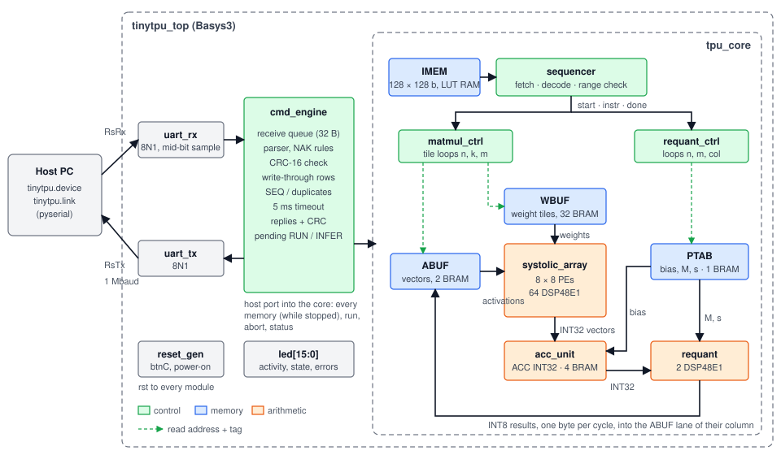
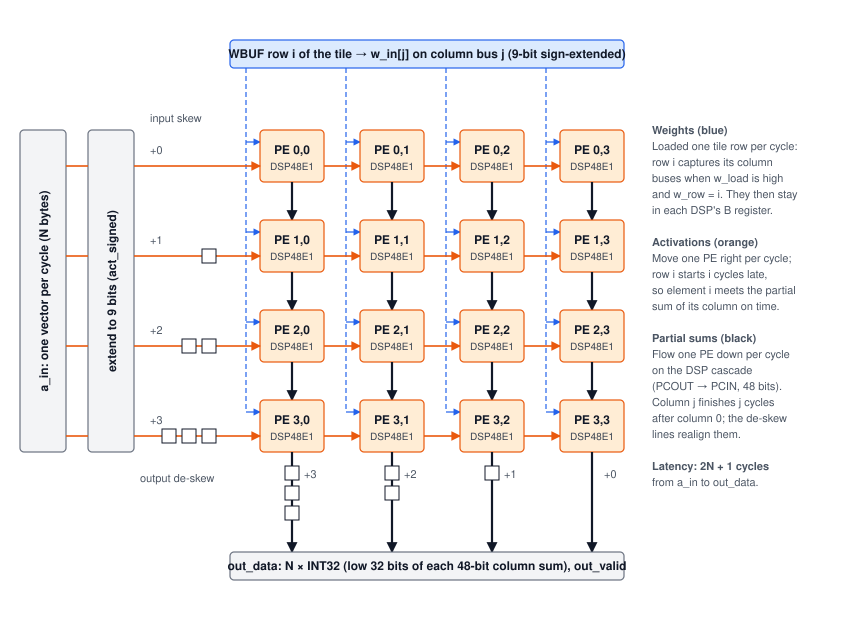
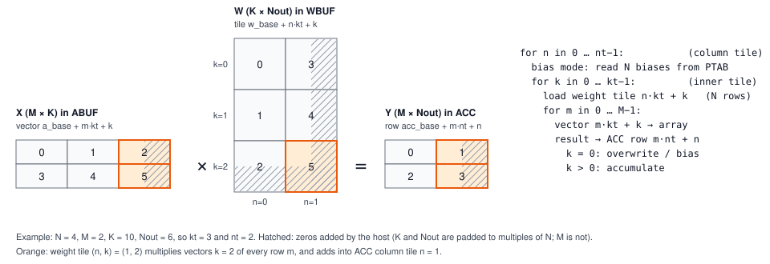
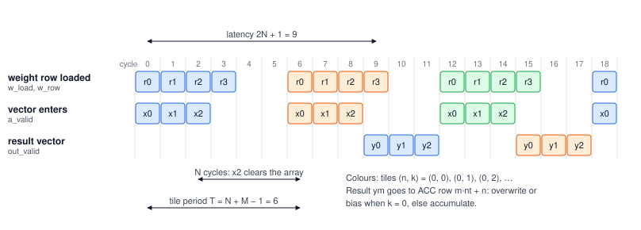
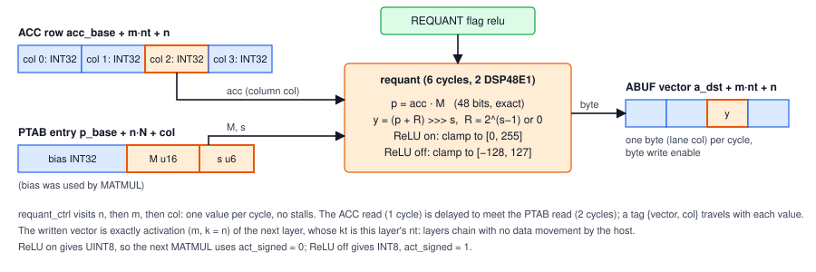

# Architecture

This page shows how TinyTPU is put together and how data moves through it. It ties together the reference pages:

- the [ISA](isa.md): instructions, layouts and errors
- the [memory map](memory_map.md): depths and byte order
- the [UART protocol](uart_protocol.md): packets and commands
- the generated [RTL module reference](rtl/index.md): ports, parameters and latencies

Those pages are the specification; this page explains it. The diagrams are drawn for small sizes (N = 4) to stay readable. The board build uses **N = 8**.

## Block diagram

The design has two halves. **`tinytpu_top`** handles the board: it synchronises the reset button, runs the UART, and holds the packet engine. **`tpu_core`** is the TPU itself, with no knowledge of the UART.

- **Host link:** `uart_rx` and `uart_tx` run 8N1 at 1 Mbaud. **`cmd_engine`** implements the [protocol](uart_protocol.md): it checks the CRC, writes payloads straight into memory as they arrive, answers duplicates without re-executing them, and sends replies. It reaches the core through one **host port**, which can read and write every memory and start, abort and query programs.
- **Control:** the **sequencer** fetches 128-bit instructions from IMEM and decodes them. It checks every address range *before* an instruction starts, then hands it to an execution unit: **`matmul_ctrl`** or **`requant_ctrl`**. Each unit is an address generator for nested tile loops. It issues buffer reads with a tag, and the tag comes back with the data to steer the datapath.
- **Datapath:** **WBUF** feeds weight tiles and **ABUF** feeds activation vectors into the **systolic array** (64 DSP48E1). **`acc_unit`** applies array results to INT32 rows in **ACC**. **`requant`** turns those rows back into bytes in ABUF, using per-channel parameters from **PTAB**.

Only one instruction runs at a time, and the host may touch memories only while no program runs. So no memory port ever needs arbitration: each one is a 2:1 mux between the datapath and the host.

## Life of an inference

With the weights, parameters and program already on the board, one inference is one `INFER` request (see the [ISA example](isa.md#example-a-196-64-10-network)):

1. The host sends `INFER` with the input vectors. `cmd_engine` streams them into ABUF as they arrive and checks the CRC at the end. Nothing runs if the CRC is bad.
2. The engine starts the sequencer at the given PC. The program runs one instruction at a time, `MATMUL` then `REQUANT` per layer, until `HALT`.
3. When the program stops, the engine sends one reply: the status block, then the output vectors read from ABUF.

Between layers, nothing goes back to the host. Each `REQUANT` leaves its results in the exact layout the next `MATMUL` reads ([below](#requantization-and-chaining-layers)).

## Numbers through the datapath

| Stage | Format | Where |
|---|---|---|
| Weights | INT8, −127…127 (symmetric) | WBUF |
| Activations | UINT8 or INT8, chosen per MATMUL by `act_signed` | ABUF |
| Array inputs | 9-bit signed: activations zero- or sign-extended once at the array edge | array edge |
| Products, column sums | Exact; partial sums run down each column on the 48-bit DSP cascade | PEs |
| Array result | Low 32 bits of each column sum (exact: an N-term sum of products fits easily) | array output |
| Accumulators | INT32, wrapping. The host refuses any job where wrapping could happen: it requires K · 32385 + the largest bias magnitude < 2³¹. | ACC |
| Requantized output | `clamp((acc · M + R) >>> s)`: UINT8 with ReLU, INT8 without | ABUF |

The NumPy reference model, `tinytpu.model`, uses exactly these rules. Every simulation test compares against it bit for bit.

## Systolic array

The array is **weight-stationary**: a weight tile is loaded once, then any number of activation vectors stream through it.

- **Processing element:** each PE is one DSP48E1. It multiplies its stationary weight by the activation passing through and adds the partial sum from the PE above. It then passes the activation right and the sum down.
  - The weight sits in the DSP's B register.
  - The sum travels on the DSP's dedicated PCOUT → PCIN cascade, so the column adders cost no fabric logic.
- **Weight loading:** WBUF row *i* of a tile is put on N column buses, and only PE row *i* captures it. A tile loads in N cycles, and its first vectors can stream in during those same cycles.
- **Input skew:** a partial sum moves down one row per cycle, so element *i* of a vector must reach row *i* one cycle after element *i* − 1 reaches row *i* − 1. Row *i* is therefore delayed *i* cycles before it enters, and each element meets its column's partial sum exactly on time.
- **Output de-skew:** activations also move one PE right per cycle, so column *j* finishes *j* cycles after column 0. Delaying it a further N − 1 − *j* cycles brings all N results of a vector out together, **2N + 1 cycles** after the vector went in.

At N = 8, Vivado maps this to exactly 64 DSPs with 56 cascade links. The only fabric left is the skew and de-skew registers (871 FFs, 11 LUTs).

## One MATMUL: tiling and timing

### Tiling

One `MATMUL` computes a whole layer, `Y = X · W` (plus bias), for any size that fits the memories:

- The host pads K and Nout to multiples of N, and stores W as N × N tiles and X as N-element vectors in the [canonical layouts](isa.md#data-layout-canonical).
- **`matmul_ctrl`** walks the tiles in order *n* (output column tile), *k* (inner tile), *m* (row). Each weight tile is loaded once, and every row's matching vector streams through it.
- The first *k* tile of each output row **overwrites** its ACC row, or starts it from the **bias** in bias mode. The others **accumulate** onto it.
- All addresses are formed by adding constants as the loops advance, so no multipliers are needed.

### Timing

For each tile, `matmul_ctrl` issues N weight-row reads, then M vector reads one cycle later. ABUF's read latency is one cycle shorter than WBUF's, so vector 0 meets row 0 at the array. The next tile starts **T = max(3, N + M − 1)** cycles after the previous one:

- **The array's rule:** the next tile's row 0 may enter only N cycles after the last vector, once that vector has passed every PE. `tb/test_feeder.py` shows that one cycle less corrupts a result.
- **The 3:** `acc_unit` updates a row with a 3-stage read-add-write pipeline, so updates of the same row must be at least 3 cycles apart. This only matters at N = 2.

So the array is busy for M of every N + M − 1 cycles: a full-length batch (M ≫ N) keeps it nearly always busy, and a single vector (M = 1) uses 1 cycle in N.

**No FIFOs:** the buffers have fixed latencies, and nothing downstream ever stalls. Each read's tag (load row *i*, or a vector is valid) comes out of the buffer with the data and drives the array directly.

**Accumulators:** each vector read also pushes its ACC row and mode into a small queue. Each array result pops it, so `acc_unit` gets the right row at the right time without knowing the array's latency.

## Requantization and chaining layers

**`REQUANT`** turns a layer's INT32 accumulators into the next layer's 8-bit activations, one value per cycle:

- `requant_ctrl` reads an ACC row and the column's PTAB entry, and sends the value through the shared requantizer (2 DSP48E1, 6 cycles).
- It writes the result byte into its lane of the ABUF vector, using the BRAM's byte write enables, so no packing logic is needed.
- **Rounding** is round-half-up: `R = 2^(s−1)`, or 0 when `s = 0`. There are no zero points.

**Chaining:** ACC row `m·nt + n` becomes ABUF vector `a_dst + m·nt + n`. That is exactly activation (*m*, *k* = *n*) of the next layer, whose kt is this layer's nt. So a network is just `MATMUL` + `REQUANT` per layer, with nothing for the host to rearrange in between.

**ReLU sets the next layer's mode:** ReLU on gives UINT8 [0, 255], so the next MATMUL uses `act_signed = 0`. ReLU off gives INT8 [−128, 127], with `act_signed = 1`.

## Control and errors

- **Stored program:** a straight-line list of macro instructions: no branches, loops or registers. The PC only moves forward, so every program ends at `HALT`, at an error, or by running past the end of IMEM.
- **Checks before execution:** the decoder rejects illegal opcodes, non-zero reserved bits, `acc_mode 11` and zero counts (errors 1–4). `range_check` computes the highest address each memory will see and compares it with the memory's depth (error 5).
  - Both run before the instruction starts, so a faulting instruction writes nothing. The address generators therefore never produce an out-of-range address.
  - `range_check` uses shift-and-add products, so it needs no DSPs and takes 14 cycles.
- **`act_signed` stability:** the sequencer holds the instruction word steady while it executes, so the array's mode can't change mid-instruction.
- **ABORT** stops issuing work at once and lets work already issued drain. The core then goes idle with error 0, and the PC at the instruction that was running.
- **Status:** state, error code and PC are reported by `STATUS` and in every RUN / INFER reply, and shown on the LEDs ([Using the board](host.md#leds)).

## Where the time goes

UART bandwidth, not compute, limits throughput. Take the [ISA example](isa.md#example-a-196-64-10-network) network, 196 → 64 → 10 at N = 8:

| Part | Size | Time |
|---|---|---|
| `INFER` request: header, arguments, 25 input vectors, CRC | 217 bytes | 2.2 ms at 1 Mbaud (10 µs per byte) |
| Program on the board: both layers | about 2,000 cycles | about 20 µs at 100 MHz |
| Reply: header, status, 2 output vectors, CRC | 31 bytes | 0.3 ms |

The array is busy for well under 1% of each inference. This is why the design favours simplicity over array speed, and why `INFER` exists: only the input and output cross the link.

## Resources and timing

Full build of `tinytpu_top` at N = 8, Vivado 2025.2, routed at 100 MHz. This is the committed baseline, `syn/baseline.json`:

| Resource | Used | Device | Ceiling |
|---|---|---|---|
| Slice LUTs | 3,702 | 17.8% | ≤ 5,200 (25%) |
| Slice registers | 4,185 | 10.1% | ≤ 6,240 (15%) |
| Block RAM (36 Kb tiles) | 39 | 78% | ≤ 40 |
| DSP48E1 | 66 | 73% | exactly 66 |
| Setup slack (WNS) / hold slack (WHS) | +1.075 ns / +0.035 ns | | ≥ 0 |
| Power (vectorless estimate) | 0.113 W | | for comparison only |

Per module, from out-of-context synthesis (`syn/ooc.tcl`). Slack is the post-synthesis estimate, not the routed figure:

| Module | DSP | BRAM | LUT | FF | Notes |
|---|---|---|---|---|---|
| `systolic_array` | 64 | 0 | 11 | 871 | 56 cascade links; the FFs are skew registers |
| `acc_unit` | 0 | 4 | 540 | 794 | ACC: 512 rows × 256 bits |
| `requant` | 2 | 0 | 284 | 110 | 1 cascade link, +3.9 ns |
| WBUF / ABUF / PTAB (`buffer_ram`) | 0 | 32 / 2 / 1 | 198 / 96 / 77 | 79 / 4 / 10 | |
| `sequencer` | 0 | 0 | 362 | ~400 | with decoder and range check, +3.3 ns |
| `matmul_ctrl` / `requant_ctrl` | 0 / 2 | 0 | 257 / 508 | | `requant_ctrl` includes `requant` |
| `tpu_core` | 66 | 39 | 2,495 | 2,668 | +2.97 ns |
| `cmd_engine` | 0 | 0 | 1,620 | 1,097 | +2.07 ns |

- **Worst routed paths:** the host's read side into WBUF: the engine's transmit state to the read enable, and the sequencer state through `host_sel` to the read-address mux of WBUF's 32 BRAMs.
- **Host writes** come from registers one cycle after a row is complete. That took the routed slack from +0.73 ns to +1.08 ns.

## Verification map

Three tiers (details in `AGENTS.md` §5):

1. **Simulation:** cocotb + Verilator, at N = 2 and 4 on every push, and N = 8 on demand. Bit-exact against `tinytpu.model`, with every assertion checked live.
2. **Formal:** SymbiYosys, for the control logic only.
3. **Implementation:** Vivado, local only (figures above).

| Module | Simulation (`tb/`) | Formal (`formal/`) |
|---|---|---|
| `uart_rx`, `uart_tx` | `test_uart.py`: `CLKS_PER_BIT` 8 and 100, ±3% baud error, framing errors | `uart.sby`: frames arrive exactly, bad stop bits flagged, bounded latency |
| `sync_fifo` | `test_sync_fifo.py` | `sync_fifo.sby`: no entry lost, duplicated or reordered (depths 2, 4, 8) |
| `crc16_ccitt` | `test_crc16.py`, against `tinytpu.crc` and `binascii.crc_hqx` | (replaced by a stub in proofs) |
| `pe`, `systolic_array` | `test_pe.py`, `test_systolic_array.py`: both modes, extreme values, the exact tile-spacing minimum | |
| `buffer_ram` | `test_buffer_ram.py`; `test_feeder.py` (buffers + array timing) | |
| `acc_unit`, `requant` | `test_acc_unit.py`, `test_requant.py`: wraparound, rounding ties, clamp edges, `s = 0` | |
| `instr_decode`, `range_check` | `test_instr_decode.py` (every single-bit flip), `test_range_check.py` | |
| `sequencer` | `test_sequencer.py`: traces equal `Machine`'s; ABORT at every cycle | `sequencer.sby`: fetch order, dispatch rules, termination bounds |
| `matmul_ctrl` | `test_matmul_ctrl.py`: every ACC word equals `Machine`'s | `matmul_ctrl.sby`: array timing, tile period, ABORT, exact read / result counts |
| `requant_ctrl` | `test_requant_ctrl.py` | |
| `tpu_core` | `test_tpu_core.py`: networks, the ISA example program, random programs with error halts | |
| `cmd_engine` | `test_cmd_engine.py`: every command and NAK code, duplicates, timeouts, noise | `cmd_engine.sby`: reply framing, one reply per request, memory access only while stopped |
| `tinytpu_top` | `test_tinytpu_top.py`: the real host code over simulated UART pins; the board self-test; link recovery | |
| Host package | `test_model.py`, `test_isa.py`, `test_link.py`, `test_selftest.py`, `test_baseline.py` | |

A proof or testbench only counts as done once it has been run against deliberately broken RTL and failed (`AGENTS.md` §5).
